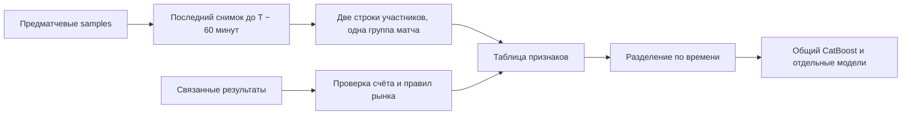

# Подготовка общей модели для пяти видов спорта

Пользователь выбрал первую цель: **вероятность победы выбранного участника**
на явно указанном рынке. Для футбольного исхода 1X2 ничья означает `0`
для обоих участников. Победа в основное время и победа в матче имеют разные
контракты и сохраняются как признак `market_scope`.

Первая реализация готовит данные для общего CatBoost и сравнения с отдельными
моделями. Экспериментальный CPU-тренер и перенос на отдельный VPS описаны
в [инструкции сервера обучения](training-server.md). На пользовательских данных
модель ещё не обучена и качество не оценено.
Сбор сохраняет полные и частичные снимки без ограничения срока хранения.



## Первая команда: аудит готовности

После обновления кода на VPS:

```bash
cd /opt/doscbot-collector/app &&
systemctl stop doscbot-collector.service &&
git pull --ff-only origin feat/fresh-sports-collector &&
systemctl start doscbot-collector.service &&
.venv/bin/python -m collector --state-dir /var/lib/doscbot-collector/data prepare-training
```

Команда открывает только собственную базу сборщика в режиме чтения.
Не запускает парсеры, не подключается к сети, не импортирует старый `finding`,
не меняет базу и без `--output` не создаёт экспорт. Новые зависимости и GPU
на этом этапе не требуются. Текущий сбор продолжает работать.

Отчёт `doscbot.training-readiness.v1` показывает уникальные события, число строк
участников, полные/частичные снимки, количество меток и причины пропусков по
каждому спорту. `without_horizon_sample` учитывает матчи, у которых нет снимка
не позднее выбранного горизонта; исходные снимки при этом не удаляются.

## Версионированная таблица признаков

При необходимости можно создать компактный отдельный экспорт:

```bash
.venv/bin/python -m collector --state-dir /var/lib/doscbot-collector/data \
  prepare-training --output /var/lib/doscbot-collector/training/prep-v1
```

Выходной каталог должен быть новым и находиться вне каталога базы и `finding`.
Повторная запись поверх существующего экспорта запрещена. Файлы:

- `rows.jsonl`: признаки, отдельная целевая метка и происхождение каждой строки;
- `schema.json`: фиксированный список разрешённых признаков и их типов;
- `manifest.json`: параметры, границы, версия схемы, отпечаток кода подготовки,
  счётчики и SHA-256 строк.

Манифест записывается последним. Для будущего обучения нужен законченный
экспорт с совпадающим SHA-256. Сырой ответ источника и большие текстовые блоки
не копируются в признаки.

Версия v1 включает спорт, турнир, порядок участника, единицы счёта, область
рынка, коэффициенты и нормированные обратные коэффициенты, маржу, доступную
форму, проверяемые сезонные показатели и признаки полноты. Для футбола и
хоккея доступны голевые показатели; они не превращаются в очки или сеты
остальных видов спорта. Это начальный набор: подачи, травмы, составы и другие
ещё не проверенные извлечения из произвольных API-путей сюда не добавляются.

Числовые пропуски остаются `null` с отдельным индикатором `__missing`.
Настоящий ноль остаётся нулём. `home`/`away` означают порядок участников
источника, а не доказанное преимущество домашней площадки. Идентификаторы
событий и текст результата находятся вне `features`.

## Один матч и временные ограничения

По умолчанию выбирается один последний снимок **не позднее чем за 60 минут**
до начала, даже если более поздний снимок полнее. Горизонт можно явно менять
через `--lead-minutes`; это параметр производной выборки, не срок хранения.

Из этого снимка создаются две строки — для первого и второго участника.
Обе имеют один `event_group`, один снимок и одну часть выборки. Повторные
наблюдения одного матча не считаются независимыми матчами. Стадия, связка
события/статистики, контрольная сумма и все времена проверяются повторно.
Будущие расписания, произвольные числовые API-поля и счёт целевого матча
не становятся признаками.

Границы задаются явно, после накопления подходящих дат:

```text
--valid-from <ISO-время с часовым поясом> --test-from <более позднее ISO-время>
```

Матчи до первой границы относятся к `train`, между границами — к `validation`,
после второй — к `test`. Для train используются только результаты/исправления,
полученные к началу validation; для validation — полученные к началу test.
Поздняя корректировка не подменяет информацию, доступную при обучении.
Неразмеченные строки сохраняются с причиной и исключаются из обучения.

Балансирующие веса по спорту вычисляются только на размеченном train.
Количество тестовых матчей на эти веса не влияет. До задания границ строки
имеют `partition: unassigned`.

`structurally_ready` означает только наличие размеченных частей по каждому
запрошенному спорту и обоих классов в train. Это не оценка достаточности объёма
или качества модели. На первых днях накопления `false` и
`time_boundaries_missing` ожидаемы: сначала смотрим реальные счётчики, затем
задаём временные границы.

## Разметка результатов: поддерживаемый первый контракт

Нативные ID ResultService подтверждены присланными записями: футбол 1,
баскетбол 2, хоккей 4, теннис 5, волейбол 23. Это отдельное пространство ID,
которое не приравнивается к `_sid` провайдера.

Результат должен быть связан сборщиком с тем же событием, спортом, порядком
участников и временем начала. Первый адаптер использует архивный ResultService
и проверяет нормальную структуру завершённого счёта:

- футбол: два тайма и совпадение их суммы с общим счётом;
- хоккей: три периода с тем же условием;
- баскетбол: четыре четверти с тем же условием;
- теннис: подтверждённый best-of, число выигранных сетов и законченные сеты;
- волейбол: подтверждённый best-of, законченные партии до 25 очков и решающая
  партия до 15 с требуемой разницей.

Присланные пять реальных строк счёта проходят эти проверки; для тенниса и
волейбола дополнительно нужен best-of из предматчевого виджета. Новые захваты
сохраняют `bestof` и `numberofperiods` явно; для прежних ищутся точные поля в
сохранённых `match_info_statshub` (`match.bestof`) и `stats_match_get` (`bestof`)
с тем же ID статистики. Детальный документ может не содержать формат, хотя
соседний общий ответ того же предматчевого захвата его содержит. Источник подтвердил
`numberofperiods=5` у предстоящего волейбольного матча: это поле разрешено как
запланированный формат только при явном статусе «не начался» (`0`) и отсутствии
текущего счёта. Конфликт значений отвергается. Количество сыгранных партий
не заменяет запланированный формат; пустое поле остаётся неизвестным.

Если ограниченная проекция не сохранила нужные поля, подготовка читает сырые
`widget_json` того же события, ID статистики и `capture_id`. Проверяет SHA-256,
успешный полный ответ, порядок UID участников, спорт и предматчевое состояние.
И время наблюдения, и время получения должны быть не позже `as_of` снимка.
Другой захват или более поздняя история не восстанавливают формат автоматически.
Доказательства остаются метаданными результата и не попадают в признаки.

Сравнение участников учитывает отображаемый неразрывный дефис (`‑`) и обычный
дефис (`-`), сохраняя прочие символы и порядок сторон. Сдвиг старта больше
15 минут принимается только как подтверждённая задержка: нужны собственные
сохранённые версии нативного события до снимка и после изменения, с тем же
event ID, radar ID, спортом и участниками; radar ID должен совпасть с ID виджета.
Поздняя версия должна быть получена не позже связанного результата.
Первоначальные время снимка, признаки и время разбиения не переписываются.
Перенос на более раннее время и отсутствие подтверждений остаются неразмеченными.

Для разбора пропусков добавлен необязательный `--diagnostic-examples 1`
(допустимо 0–3 примера на спорт/причину, всего не более 20). Он показывает
ограниченные публичные поля выбранного снимка и связанного результата.
Для неизвестного best-of дополнительно ищет сохранённый сырой ответ того же
захвата, а также более позднюю запись точного ID матча в истории участников.
Учитываются время получения и граница доступности метки; диагностика не
подключается к сети и не добавляет меток или признаков из найденной истории.
Исходная база не меняется. Если подтверждения формата нет, метка не ставится.

Неоднозначные рынки, неизвестный период, лишние периоды овертайма, специальные
отметки, снятия и неподдерживаемые форматы остаются без метки с объяснением.
Например, NCAA с двумя половинами, пляжный волейбол и некоторые тай-брейки
потребуют отдельных проверенных правил. Данные при этом сохраняются.
Разметка только обычных матчей создаёт отбор примеров, особенно при исключении
овертаймов: перед оценкой общей модели этот пробел нужно измерить и устранить.
Ничья на двухисходном рынке не превращается в два поражения.

Это адаптер исхода по архивному счёту, **не расчёт ставки букмекером**.
Отмена, возврат, техническое поражение и специальные правила расчёта требуют
дополнительной подтверждённой информации. Для будущей проверки доходности
нужен отдельный слой расчёта ставок. Вероятность ничьей 1X2 нельзя получать
простым вычитанием двух независимых бинарных прогнозов.

## Следующие этапы

1. Получить реальный отчёт `prepare-training` на VPS и устранить конкретные
   причины отсутствующих меток или признаков, сохраняя источник и область рынка.
2. Накопить достаточно независимых завершённых матчей и выбрать временные
   границы. Размеры частей и разброс по лигам важнее количества JSON-снимков.
3. Использовать отдельную среду и CPU-тренер `train-baseline` для первого общего
   CatBoost. Затем сравнить с отдельными моделями на одинаковых группах/датах.
4. Сравнить с вероятностями из коэффициентов: log loss, Brier score,
   калибровка и показатели отдельно для каждого спорта и уровня полноты.
5. Проверить устойчивость на последующих датах и запустить прогнозы в режиме
   наблюдения. Выдача прогнозов первой версии работает на CPU.

Для начала ориентир — 8 vCPU / 16 ГБ RAM. Точный расход обучения измеряется
на производной таблице; GPU для подготовки и первого CatBoost не нужен.
